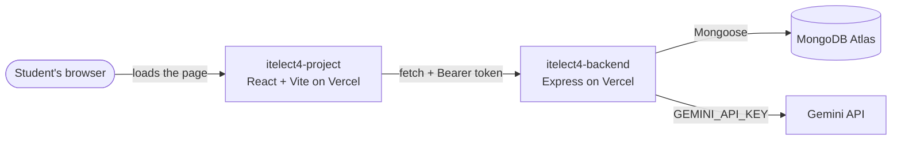

# itelect4-project

[](https://github.com/meloimagpantay/itelect4-project/actions/workflows/ci.yml)

The ITELECT4 class demo, end of Session 12: a Course Submission Tracker
in React and TypeScript. It lists courses, logs a student in against
`itelect4-backend`, records their submissions, and asks Gemini for a
review of a project description. Annotated so each session can be
taught by reading the code instead of typing it live.

- **Live app:** https://itelect4-project-xxxx.vercel.app
- **API it calls:** https://itelect4-backend-xxxx.vercel.app
- **Backend repo:** https://github.com/meloimagpantay/itelect4-backend

## Architecture



The browser only ever talks to the two Vercel addresses. The database
and Gemini are reached by the backend alone, so neither the Atlas
password nor the Gemini key is ever sent to the browser.

## Tests and CI

```
npm test             # Vitest, once: 3 files, 6 tests
npm run test:watch   # Vitest, re-running on every save
```

| File | What it checks |
|---|---|
| `src/components/SubmissionBadge.test.tsx` | Renders the score, and "Not graded yet" when there is none |
| `src/hooks/useToggle.test.ts` | The value starts where it was told to and flips on each toggle |
| `src/pages/LoginPage.test.tsx` | An empty or invalid form shows the schema's messages and sends no request |

`.github/workflows/ci.yml` runs `npm ci`, `npm run lint`, `npm test` and
`npm run build` on GitHub's machine on every push. The badge above is
green when the latest run on `main` passed. No secrets are needed: the
tests set their own `VITE_API_URL` in `vite.config.ts` and never call
the API.

## What Session 12 changed

| File | What changed |
|---|---|
| `package.json` | `vitest`, `jsdom` and three `@testing-library` packages in devDependencies; `test` and `test:watch` scripts. |
| `vite.config.ts` | `defineConfig` comes from `vitest/config`, and a `test` block: the jsdom environment, the setup file, and a fixed `VITE_API_URL` for tests. |
| `src/test/setup.ts` | **New.** jest-dom's matchers, and `cleanup()` after every test. |
| `src/**/*.test.ts(x)` | **New.** The three test files above, each beside the file it tests. |
| `.github/workflows/ci.yml` | **New.** The CI workflow. |
| `README.md` | The badge, the architecture diagram and this section. |

## Run it — TWO terminals, and neither is json-server any more

```
# Terminal 1 — the API, in the itelect4-backend folder
npm run dev          # Express on http://localhost:4000

# Terminal 2 — the app, here
npm install
copy .env.example .env      # macOS/Linux: cp .env.example .env
npm run dev                 # Vite on http://localhost:5173
```

`.env` holds one line:

```
VITE_API_URL=http://localhost:4000
```

No trailing slash, and no `/api` on the end — `src/api/client.ts` adds
the paths. Vite bakes the value in when it starts, so changing `.env`
means restarting `npm run dev`.

Without it the app throws at import and the page is blank, with the
reason in the browser console. That is deliberate: the alternative is
every call going to `undefined/api/courses`.

The backend has to allow this origin. `CORS_ORIGIN` in its `.env`
should contain `http://localhost:5173`.

## What Session 11 changed

| File | What changed |
|---|---|
| `src/pages/ReviewPage.tsx` | **New.** A description box, React Hook Form, and a `useMutation` that calls `POST /api/ai`. The review renders as a coloured readiness badge, a summary and two lists. No `mode: "onBlur"` — see the comment in the file. |
| `src/schemas/reviewSchema.ts` | **New.** The same 20–2000 character rule, with the same messages, as the API's request schema. |
| `src/api/client.ts` | `askAi(prompt)`. Private: `request()` attaches the token. |
| `src/types/index.ts` | `AiReview` — the shape the API sends back, written to match its Zod schema. |
| `src/App.tsx` | A `/review` route inside `ProtectedRoute`. |
| `src/components/Layout.tsx` | An AI Review link. |

The Gemini key is **not** in this repo and never will be: the browser
calls `itelect4-backend`, and only the backend calls Gemini.

## What Session 10 changed

| File | What changed |
|---|---|
| `src/api/client.ts` | Rewritten. One `request()` helper: the host from `VITE_API_URL`, the `Bearer` header when the store has a token, and the API's own message when it refuses. Four invented error strings are gone. |
| `src/types/index.ts` | `ApiSubmission` also omits `studentId` — MongoDB sends 24 hex characters, not the `1` the page used to invent. `NewSubmission` is now a `Pick` of the two fields the client may send. `ApiUser` and `AuthReply` are new. |
| `src/store/authStore.ts` | `login(name)` became `setSession(token, userName)`. The store keeps a token it was given instead of inventing `demo-token-<name>`, and it deliberately does not import `client.ts`. |
| `src/schemas/authSchema.ts` | **New.** `loginSchema`, and `registerSchema` built from it with `.extend()`. |
| `src/pages/LoginPage.tsx` | Email and password, React Hook Form, and a `useMutation` that calls the API. The error under the form is the API's sentence. |
| `src/pages/RegisterPage.tsx` | **New.** Registers, then logs in with the same two values, because only `/api/auth/login` issues a token. |
| `src/pages/SubmissionsPage.tsx` | `onSubmit` sends the form values and nothing else. The invented `studentId: 1` and browser-clock `submittedAt` are gone. |
| `src/pages/CoursesPage.tsx` | The error branch names the host it tried instead of blaming json-server. |
| `src/App.tsx` | A `/register` route, outside `ProtectedRoute`. |
| `src/components/Layout.tsx` | A Register link beside Login while logged out. |
| `package.json`, `db.json` | `json-server`, the `api` script and `db.json` are deleted. The three courses live in the database now. |

## How the annotations work

Every file Session 10 touched carries last week's code, commented out,
right where it used to live:

```ts
// ===== SESSIONS 7-8: one hard-coded host, and no token anywhere ======
// export const API_URL = "http://localhost:3001";
//
// NOTE: ... why it had to change
// ===== SESSION 10: one request() helper, and a host from the env =====
```

Read the commented block, then the live code under it. The lecture
console reads its code boxes straight out of this tree, so what is on
screen and what is in these files cannot drift.

## Deploying it

Import the repo at vercel.com. Vercel picks the Vite preset by itself:
`npm run build`, output in `dist`. Add one environment variable,
`VITE_API_URL`, set to the backend's deployment address, in all three
environments.

Then put this app's address in the **backend's** `CORS_ORIGIN` and
redeploy the backend. That last step is the one everyone forgets.
